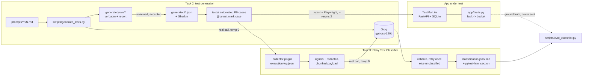

# testmu-sdet1-kartikey

[](https://github.com/kartikey3112/testmu-sdet1-kartikey/actions/workflows/ci.yml)

Submission for the TestMu AI SDET-1 "AI-Native Quality Engineering Challenge".

The ticket: *the team spends too much time writing and fixing regression tests.* This repo
attacks both halves with an LLM. **Writing:** versioned, validated prompts generate
regression cases for Login, Dashboard and the REST API, and the P0 cases are automated with
traceability back to each generated case. **Fixing:** a Flaky Test Classifier reads a test
run's execution log, including rerun evidence, and sorts every failure into *real bug*,
*environment issue* or *flaky test*. The results show up inside the test report, so triage
starts from a label, evidence and a next action instead of a red build. Both are tested
against **TestMu Lite**, a small app built for this repo with fault injection, so the
classifier's accuracy can be measured against known causes.

## Architecture



## Quickstart

Needs Python 3.11+ (developed on 3.14) and git. A free Groq key is only needed for the LLM
parts; the tests run without one.

```bash
git clone https://github.com/kartikey3112/testmu-sdet1-kartikey.git && cd testmu-sdet1-kartikey
python -m venv .venv && . .venv/bin/activate        # Windows: .venv\Scripts\activate
pip install -r requirements.txt && python -m playwright install chromium
cp .env.example .env    # then set LLM_API_KEY: free key from https://console.groq.com/keys
python -m pytest        # starts TestMu Lite itself; report in reports/run-<id>/report.html
```

Every `make` target is a one-line wrapper; the raw commands are listed below, so `make` is
optional (handy on Windows).

## How to run each part

| What | Command | Make |
|---|---|---|
| The app on its own (http://127.0.0.1:8000, test hooks on) | `TEST_MODE=1 python -m uvicorn app.main:app` | `make app` |
| Reset its database to seed data | `python -m app.seed` | `make reset-db` |
| All tests / UI only / API only | `python -m pytest` · `-m ui` · `-m api` | `make test` · `test-ui` · `test-api` |
| **Task 2:** generate cases from a prompt version | `python -m scripts.generate_tests --module login --version v4` | `make generate MODULE=login VERSION=v4` |
| Re-validate a saved response (no LLM call) | `python -m scripts.generate_tests --revalidate generated/raw/<file>.json` | |
| Export accepted cases to Gherkin | `python -m ai.testgen.to_gherkin` | `make gherkin` |
| Rebuild `prompts.md` / check it | `python -m scripts.build_prompts_md [--check]` | `make prompts-md` |
| Traceability (case → test → status) | `python -m scripts.build_traceability` | `make traceability` |
| **Task 3:** run with faults and classify at the end | `FAULTS=BUG_DELETE_NOT_PERSISTED,FLAKY_UNSORTED_ORDER python -m pytest --reruns 2` | |
| Classify an earlier run | `python -m ai.classifier.classify --run <run-id>` | `make classify RUN=<run-id>` |
| Evaluate the classifier across fault scenarios | `python -m scripts.eval_classifier` | `make eval` |

Fault names and their true bucket are in [`app/faults.py`](app/faults.py). Classification
runs at the end of any pytest session that had failures, when `LLM_API_KEY` is set; turn it
off with `TESTMU_CLASSIFY=0`.

## Where everything is

| Deliverable | Location |
|---|---|
| Prompts, every version exactly as run, with notes on what changed | [`prompts.md`](prompts.md) (built from [`prompts/`](prompts/), reasons in [`prompts/revisions.md`](prompts/revisions.md)) |
| Generated test cases | [`generated/*.json`](generated/), [`generated/gherkin/`](generated/gherkin/), raw responses and validation reports in [`generated/raw/`](generated/raw/) |
| Automated cases and traceability | [`tests/`](tests/), [`docs/traceability.md`](docs/traceability.md) |
| LLM integration (Option B) and the reason for choosing it | [`ai/classifier/`](ai/classifier/) (rationale in [`ai/classifier/__init__.py`](ai/classifier/__init__.py)) |
| Sample output with the LLM response inside the test report | [`samples/eval-20261022T200611Z-mixed/`](samples/eval-20261022T200611Z-mixed/README.md) |
| Classifier evaluation | [`samples/eval/`](samples/eval/) |
| AI usage | [`ai-usage-log.md`](ai-usage-log.md) |
| Decisions and trade-offs | [`docs/decisions.md`](docs/decisions.md), [`docs/prompt-design.md`](docs/prompt-design.md) |

## Results (measured)

**Test generation (Task 2)**

| Module | Prompt versions | Accepted | Cases | P0 | Automated |
|---|---|---|---|---|---|
| Login | v1–v4 | v4 | 15 | 7 | 11 |
| Dashboard | v1–v3 | v3 | 16 | 8 | 11 |
| REST API | v1–v4 | v4 | 24 | 8 | 12 |

- 34 tests are linked to generated cases, plus 3 hand-written smoke tests: 37 of 37 pass
  against the clean app (3 consecutive full runs).
- Two generated cases were left out because their expectations were wrong (DASH-008,
  DASH-010; reasons in `docs/traceability.md`).
- Each injected real bug makes exactly the tests that target it fail.

**Flaky Test Classifier (Task 3)**

Evaluated with `scripts/eval_classifier.py` on fault scenarios whose true cause is known
(`app/faults.py`), with `--reruns 2`, `openai/gpt-oss-120b` and prompt `classifier.v1`.
Full report: [`samples/eval/`](samples/eval/README.md).

| Scenario | Scored failures | Correct |
|---|---|---|
| real bugs only | 4 | 4 |
| environment issues only | 37 | 37 |
| flaky faults only | 5 | 4 |
| mixed (bugs + flaky, with `/health` failing as a trap) | 9 | 8 |
| **overall** | **55** | **53 (0.964)** |

- **Without the environment scenario,** whose 37 failures are easy 5xx/connection cases:
  **16/18 (0.889).** It's one run per scenario, so expect variation.
- **Both misses are the same test** (DASH-005, the pass-rate widget). In each case, one run
  could not tell "slow every time" from "broken": three identical timeouts looked like a
  real bug, and a real bug mixed with random latency looked flaky. Run history fixes this
  (see "next").
- **No bug or flaky failure was blamed on the environment** in the mixed run, even though
  `/health` was failing throughout.
- **Two attempts didn't count and are kept as evidence:** one hit Groq's daily token limit
  (D23), and one exposed a client bug, Groq rejecting JSON without our retry (D25, fixed).

**Sample output with the LLM response inside the test report:**
[`samples/eval-20261022T200611Z-mixed/`](samples/eval-20261022T200611Z-mixed/README.md):
the self-contained `report.html`, `classification.json`/`.md`, and screenshots.

## Key decisions

All in [`docs/decisions.md`](docs/decisions.md). The ones most worth reading:
own app under test with fault injection (D2), test clock instead of waiting (D9), schemas
written on the test side (D13), JSON mode plus our own validation (D17), payload compaction
and code-computed signals (D20), never guessing a label (D21), quota handling (D23), retrying provider-rejected JSON (D25).

## Known limitations

- **Free-tier quota.** Groq's free tier allows 200,000 tokens per day for this model. Test
  generation for all prompt versions used about 110k (measured). The evaluation's
  environment scenario alone used about 91k, because every test fails. Test generation and
  the evaluation don't fit in the same day; the code stops cleanly on the daily limit and
  `--reuse` resumes the evaluation (D23).
- **Classifier accuracy is from small samples:** 55 scored failures, one run per scenario,
  and one prompt version. The two misses point at a real blind spot, not noise (see
  Results).
- **Temperature 0 is not deterministic on Groq.** Re-running a prompt gives the same
  structure and coverage, not the same wording.
- **One run can't tell a stuck widget from a slow one.** A flaky test that happens to fail
  the same way on all three attempts looks exactly like a real bug. Run history is needed
  (see "next").
- **The classifier sees one run at a time** and nothing about recent code changes.
- **pytest-html internals.** The per-test LLM column uses pytest-html's internal row data,
  so `pytest-html` is pinned to 4.2.0.
- **TestMu Lite is a test fixture**, not a product: no CSRF protection, single process,
  in-memory rate limiting.

## What I'd build next

1. **Option A, Failure Explainer**, reusing the collector: a per-failure explanation for the
   tests the classifier marks `real_bug`, with the trace and screenshot.
2. **Flakiness history across runs**: keep classifications per commit, and flag tests that
   pass and fail on the same commit, plus a rolling flip rate. This fixes the "three identical
   timeouts" blind spot.
3. **Locator-repair suggestions** delivered as pull requests, never applied automatically.
4. **Retrieval of past classifications** as few-shot examples in the classifier prompt.
5. **Prompt regression tests**: replay saved execution logs through new prompt versions and
   compare labels before accepting a change.
6. **Cost and latency tracking per LLM call**, with a budget guard before a run starts.
